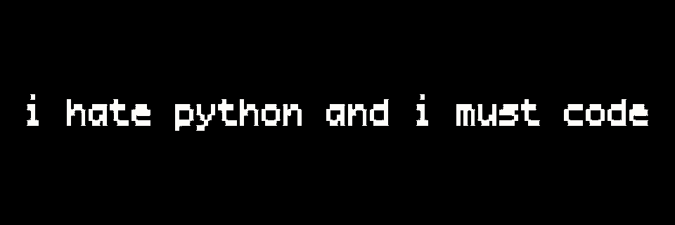
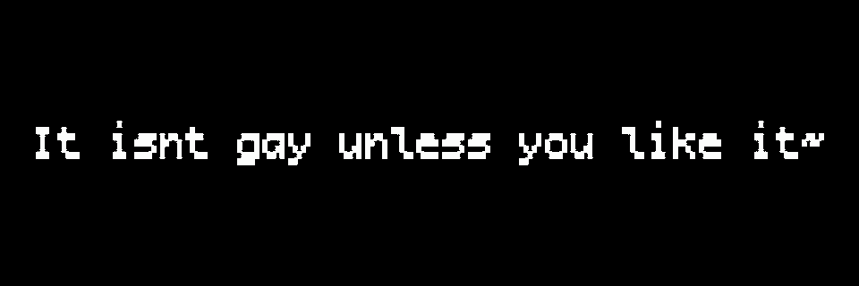

# Dum shit i made for fun 

## previews





default font: `assets/DepartureMono.otf`

## requirementssssss 

- `moderngl` and `numpy` gpu render stuff
- `Pillow` text rasterisation, sdf, png export, gif
- `tkinter` uhh yeah obviously

```bash
.venv/bin/python renderer.py
```
default res is 960x480

meow
`--preview-scale 1` for full size prev
use `--width` / `--height` to change yeh

keys:::::
space pause/continue
r is restart
f5 reload shaders
s save is export current frame into png in output
q/esc quit

```bash
.venv/bin/python renderer.py --text $'change ur text here to wutever\\n this is line break'
```
yeh `\\n` to new line

```bash
.venv/bin/python renderer.py --preview-fps 30
```
u can change the fps

## export as gif 

```bash
.venv/bin/python renderer.py --export output/shit.gif
## or
.venv/bin/python export.py output/shit.gif
```
## uhh 
this thing has anim states: idle, animate, hold, dissolve

idle is self explanatory u get it
animate is the reveal sweep duration. `hold` keeps the shader's trailing smoke
moving after the reveal, before the dissolve starts. `--dissolve` sets the
dissolve sweep duration.

they're configurable with `--idle`, `--animate`, `--hold`, and `--dissolve`.

shader speed is `--speed` default `1.0`. The reveal and dissolve sweeps use
normalized progress, so each reaches its endpoint at the end of its configured
duration. `--speed` controls the smoky noise motion within those sweeps.

## shaders 
open shaders/ duh, everythin is in it

```glsl
uniform vec2      uResolution;  // render size in px 
uniform float     uTime;        // time 
uniform int       uFrame;       // frame 
uniform float     uProgress;    // normalized progress within reveal/dissolve
uniform float     uHoldProgress; // residue progress from 0 to 1 during hold
uniform int       uPhase;       // 0 idle, 1 reveal, 2 hold, 3 dissolve
uniform sampler2D uSdf;         // sdf tex 
uniform vec2      uHalfSize;    // 1/2 size of the sdf box in p-space
uniform float     uRange;       // sdf distance range in p-space
```
(default) the config:
```txt
uSdf 0
uDrip 1.0
uAmp 1.0
uBlur 0.05
uFreq 1.3, 1.3, 1.2
```

# big thanks to 0b5vr, i borrowed his emphemera shaders thing from shadertoy, it's reallllly cool i love u 0b5vr!!!
i also modified da shaders so it's not entirely a copy and paste
